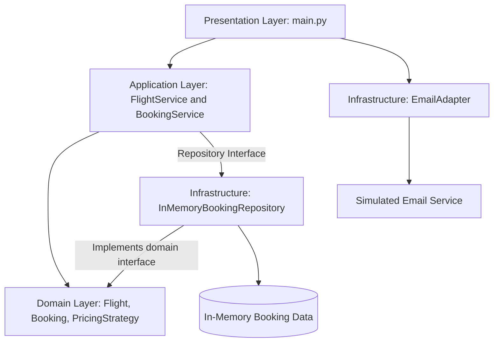

# Flight Booking System — Architecture Diagram

## Architecture Description

The Flight Booking System uses a layered modular-monolith architecture.

- Presentation Layer: Handles user input through the terminal.
- Application Layer: Manages flight searching and bookings.
- Domain Layer: Defines business models and interfaces.
- Infrastructure Layer: Handles storage and simulated email notifications.

## Architectural Decision

A modular monolith was selected because the system is small
and does not require independently deployed services.

This architecture supports separation of responsibilities,
maintainability, and testability.
