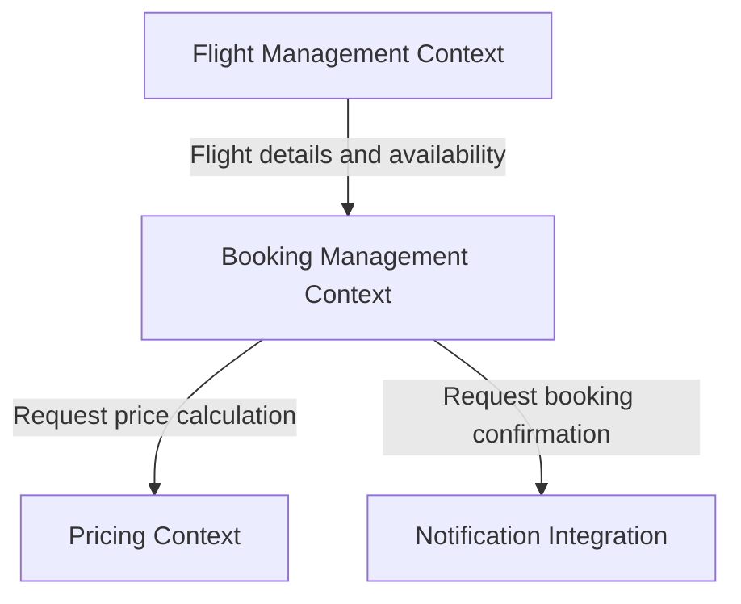

# Flight Booking System — Bounded Context Diagram

## Description

The system is divided into three conceptual
bounded contexts.

Flight Management provides flight information.

Booking Management manages reservations and
seat availability changes.

Pricing provides interchangeable pricing
strategies.

Notification handling is a supporting
integration rather than a separate deployed
service.
